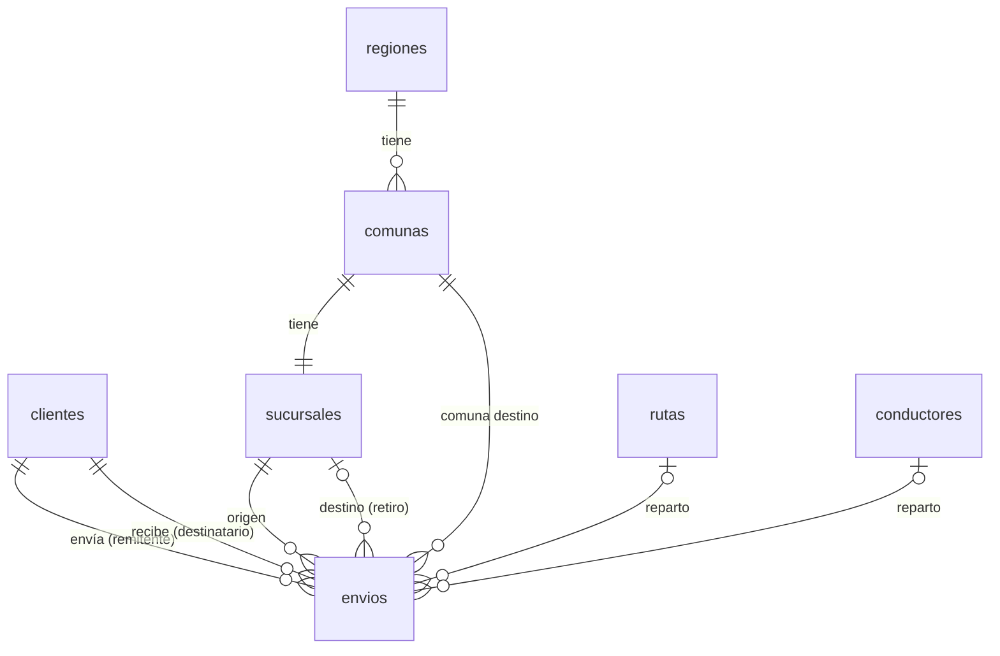

# Modelo de datos — mvp-starken

Propuesta para cargar `Book1.xlsx` (hoja **Pedidos**: 10.000 filas × 51 columnas, emisiones del
2 de enero al 17 de noviembre de 2026; hoja **Supuestos**: 4 parámetros de cálculo) en Supabase.

## Qué dice el Excel

- **Cada fila es un envío.** `ID Pedido` y `Código Seguimiento` son únicos.
- **Geografía limpia.** Hay 43 comunas, cada una pertenece a una sola región y tiene una sola
  sucursal ("Starken <comuna>"). Las 16 regiones caen en 4 zonas (Norte, Centro, Sur, Austral).
  Por eso región y zona no se guardan en el envío: se obtienen a partir de la comuna.
- **Los clientes casi no se repiten.** Hay 19.990 RUT distintos para 20.000 remitentes y
  destinatarios, y todos los RUT tienen dígito verificador válido. Teléfono, correo y dirección
  cambian en cada envío.
- **Ruta y conductor no son fijos.** Hay 867 rutas y 850 conductores, y casi todos los conductores
  aparecen en varias rutas. Por eso se guardan como asignación de cada envío, no como relación fija.
- **Los cálculos cuadran al 100 %** con la hoja Supuestos:
  - peso volumétrico = largo × ancho × alto × bultos / 4000;
  - peso facturable = el mayor entre el peso real y el volumétrico;
  - seguro = 1 % del valor declarado, con un mínimo de $1.000 si se contrata;
  - total neto = flete + seguro;
  - IVA = 19 % del neto;
  - total = neto + IVA.
- **Reglas que se cumplen siempre:**
  - Las entregas a domicilio llevan ruta y conductor, y no tienen sucursal de destino.
  - Los retiros en sucursal tienen sucursal de destino y no llevan ruta.
  - Los envíos entregados tienen fecha de entrega y "Cumple SLA" en Sí o No. Los demás tienen
    "Pendiente" y no tienen fecha de entrega.

### Rarezas (se cargan tal cual, documentadas)

| Caso | Filas | Qué pasa |
|---|---|---|
| Días de tránsito = −1 | 72 | Todos se emitieron un sábado y se entregaron el mismo día: es un efecto del conteo en días hábiles. |
| RUT con dos nombres | 6 remitentes y 3 destinatarios | Son empresas o personas distintas que comparten RUT por azar. |
| Seguro con valor declarado $0 | 9 | Se cobra el mínimo de $1.000. |
| Prefijo de ruta `LOS` | — | Se usa tanto para Los Ríos como para Los Lagos, así que la ruta no se amarra a una región. |

## Tablas

| Tabla | Filas | Columnas principales |
|---|---|---|
| `regiones` | 16 | `nombre`, `zona` |
| `comunas` | 43 | `nombre`, `region_id` |
| `sucursales` | 43 | `nombre`, `comuna_id` |
| `clientes` | ~19.990 | `rut` (único), `nombre`, `tipo_cliente` (solo si fue remitente) |
| `rutas` | 867 | `codigo` (p. ej. `MET-022`) |
| `conductores` | 850 | `codigo` (p. ej. `CND-0566`) |
| `envios` | 10.000 | ver abajo |
| `parametros` | 4 | `clave`, `valor`, `descripcion` (la hoja Supuestos) |

### `envios`

- **Identificación:** `id_pedido` (único), `codigo_seguimiento` (único, `bigint`), `emitido_en`
  (fecha + hora, `timestamptz`, hora de Chile), `canal_venta`.
- **Remitente:** `remitente_id` → clientes, `remitente_nombre`, `remitente_telefono`,
  `sucursal_origen_id`.
- **Destinatario:** `destinatario_id` → clientes, `destinatario_nombre`, `destinatario_telefono`,
  `destinatario_email`, `direccion_destino`, `comuna_destino_id`, `tipo_entrega`,
  `sucursal_destino_id`.
- **Carga:** `tipo_servicio`, `tipo_bulto`, `contenido_declarado`, `num_bultos`, `peso_real_kg`,
  `largo_cm`, `ancho_cm`, `alto_cm`, `peso_volumetrico_kg`, `peso_facturable_kg`.
- **Cobro:** `valor_declarado`, `seguro_contratado`, `condicion_pago`, `medio_pago`, `flete_neto`,
  `costo_seguro`, `total_neto`, `iva`, `total_con_iva`. Todos los montos se guardan en pesos
  enteros.
- **Operación:** `fecha_comprometida`, `fecha_entrega`, `estado`, `intentos_entrega`,
  `motivo_incidencia`, `recibido_por`, `ruta_id`, `conductor_id`, `dias_transito`, `cumple_sla`,
  `calificacion` (1 a 5, opcional).

## Decisiones

1. **Los nombres y datos de contacto se guardan en cada envío, como en la guía de despacho.** Así
   no se pierde nada en los 9 RUT con nombres en conflicto. La tabla `clientes` agrupa por RUT
   para que el producto pueda reconocer clientes que vuelven.
2. **Las listas cerradas son tipos `enum` de Postgres:** canal, tipo de cliente, zona, tipo de
   entrega, servicio, bulto, contenido, condición y medio de pago, estado, motivo de incidencia y
   cumple SLA. Si alguna lista va a crecer desde la app, conviene cambiarla a una tabla.
3. **Los montos y pesos se guardan como vienen del Excel,** con restricciones `check` que exigen
   que cuadren (por ejemplo, `total_con_iva = total_neto + iva`). No se recalculan.
4. **Las reglas del negocio quedan como restricciones `check`.** Por ejemplo: domicilio ⇔ ruta y
   sin sucursal de destino; calificación entre 1 y 5; bultos ≥ 1.
5. **Seguridad:** todas las tablas quedan con RLS activado y **sin políticas**. La API pública no
   puede leer nada hasta que definamos quién ve qué.

## Carga (hecha el 18-11-2026)

No usa la contraseña de la base:

1. La migración `supabase/migrations/20261118150131_modelo_envios.sql` crea los tipos, las tablas,
   las restricciones y los índices.
2. `scripts/excel_a_csv.py <Book1.xlsx>` convierte el Excel en `seed/envios.csv`.
3. Se crea la tabla temporal `public.stg_envios`, con todas las columnas como texto y RLS
   activado. Se le da a `anon` permiso solo de inserción, con una política que exige un código de
   lote de un solo uso (un UUID).
4. `scripts/subir_staging.py <url> <llave_publicable> <código>` sube el CSV por la API REST en
   lotes de 1.000 filas. Apenas termina, se borran la política y el permiso.
5. `scripts/cargar.sql` arma catálogos, clientes y envíos desde la tabla temporal en una sola
   transacción, y aborta si se pierde alguna fila. Después se borra `stg_envios`.

### Resultado

Quedaron 16 regiones, 43 comunas, 43 sucursales, 867 rutas, 850 conductores, 4 parámetros,
19.990 clientes y 10.000 envíos. Las siguientes sumas son idénticas a las del Excel:

| Concepto | Total |
|---|---|
| Flete neto | $214.581.090 |
| Seguro | $13.414.890 |
| Total neto | $227.995.980 |
| IVA | $43.319.616 |
| Total con IVA | $271.315.596 |
| Valor declarado | $1.871.717.000 |
| Peso real | 161.055,22 kg |
| Peso facturable | 246.425,98 kg |
| Bultos | 15.589 |

También coinciden los conteos de envíos entregados (8.874) y a domicilio (6.792), las
calificaciones y los días de tránsito.

> El repositorio de GitHub es **público**. El Excel y los archivos de carga tienen RUT, teléfonos y
> correos, así que **no se suben al repositorio**: van solo a la base de datos.
